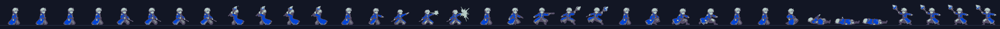
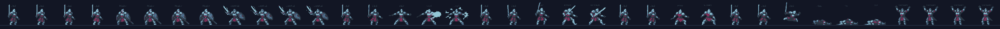
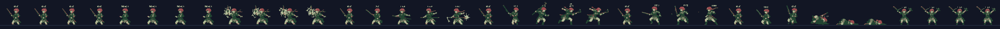
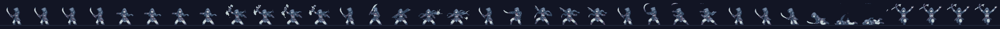
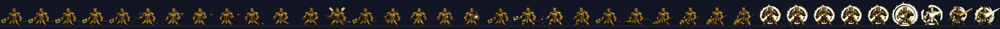
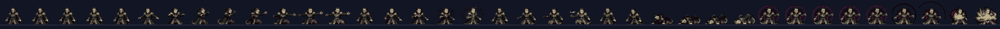

<p align="center">
  <a href="https://ko-fi.com/todd0042">
    
  </a>
</p>

---

# 🔮 Echoes of the Logos: High-Fantasy Voice JRPG

[](https://github.com/Todd0042/echoes-of-logos/releases)
[](LICENSE)
[-3DDC84.svg?logo=android&logoColor=white)](https://developer.android.com)
[](https://kotlinlang.org)
[](https://developer.android.com/jetpack/compose)
[](https://github.com/Todd0042/voice-rpg-engine)
[](https://developer.android.com/16kb-page-size)
[](app/src/test/java/com/voicerpg/engine/)
[](https://ko-fi.com/todd0042)

> **A voice-commanded high-fantasy JRPG for Android: speak your spells to fight tactical ATB battles across a 16-chapter story, with resonance scoring that rewards a well-delivered chant, bundled offline translations in five languages, and a screenless Pocket Mode that plays entirely by ear.**

---

## 📖 Table of Contents

* **Part 1 — Overview & Quick Start**
  * [🔮 What Is Echoes of the Logos?](#-what-is-echoes-of-the-logos)
  * [🪄 How a Spell Works in 3 Steps](#-how-a-spell-works-in-3-steps)
  * [📜 The 16-Chapter Campaign](#-the-16-chapter-campaign)
  * [🔗 Companion Project](#-companion-project)
  * [📸 Visual Tour](#-visual-tour)
  * [✨ Highlights at a Glance](#-highlights-at-a-glance)
  * [🚀 Quick Download & Installation](#-quick-download--installation)
* **Part 2 — Technical Documentation & Architecture Reference**
  * [1. Architecture: Built on the VoiceRPG Engine ([.engine-sync/](.engine-sync/))](#1-architecture-built-on-the-voicerpg-engine)
  * [2. Game Content ([assets/game/](app/src/main/assets/game/))](#2-game-content)
  * [3. The Party, Roles & Story-Learned Spells ([characters/](app/src/main/assets/game/characters/), [classes/](app/src/main/assets/game/classes/), [spells.json](app/src/main/assets/game/spells/spells.json))](#3-the-party-roles--story-learned-spells)
  * [4. Enemies, Weaknesses, Armour & Stuns ([enemies.json](app/src/main/assets/game/enemies/enemies.json), [DamageResolver.kt](app/src/main/java/com/voicerpg/engine/combat/DamageResolver.kt))](#4-enemies-weaknesses-armour--stuns)
  * [5. Resonance Scoring ([ResonanceEngine.kt](app/src/main/java/com/voicerpg/engine/engine/ResonanceEngine.kt), [SpellChantPresets.kt](app/src/main/java/com/voicerpg/engine/engine/SpellChantPresets.kt))](#5-resonance-scoring)
  * [6. Languages & Voice Commands ([TranslationManager.kt](app/src/main/java/com/voicerpg/engine/localization/TranslationManager.kt), [commands/](app/src/main/assets/game/commands/))](#6-languages--voice-commands)
  * [7. Chronicle, Backlog & Recap ([DialogueBacklogDialog.kt](app/src/main/java/com/voicerpg/engine/ui/story/DialogueBacklogDialog.kt), [StoryRecapEngine.kt](app/src/main/java/com/voicerpg/engine/engine/StoryRecapEngine.kt))](#7-chronicle-backlog--recap)
  * [8. Tests & Combat Balance ([balance/](app/src/test/java/com/voicerpg/engine/balance/), [balance.json](app/src/main/assets/game/combat/balance.json))](#8-tests--combat-balance)
  * [9. Repository Structure](#9-repository-structure)
  * [10. Ethics, Provenance & Licensing ([LICENSE](LICENSE), [LICENSE-MEDIA](LICENSE-MEDIA))](#10-ethics-provenance--licensing)

---

# Part 1 — Overview & Quick Start

## 🔮 What Is Echoes of the Logos?

**Echoes of the Logos** is a voice-first high-fantasy JRPG for Android. In the realm of **Solaria**, spoken language is the source of magic, and the Grand Inquisitor Malakor wants the world silent. You play **Aethel**, an invocator who casts by speaking, and you fight by saying what you want to do rather than pressing buttons.

The game has three parts:

1. **The story**: a prologue, 16 chapters in four acts and an epilogue, told through narrated dialogue and spoken choices.
2. **Battles**: Active Time Battle (ATB) fights where you speak spells and commands, and how well you deliver a chant changes how hard it hits.
3. **Pocket Mode**: the whole game read aloud and answered by voice, so it can be played with the phone in a pocket.

---

## 🪄 How a Spell Works in 3 Steps

1. **Wait for your turn**: each fighter's ATB gauge fills at a rate set by their **speed** (statuses such as chill or bless slow it or quicken it).
2. **Speak your spell**: say its name, or a fuller chant (*"Arise celestial dawn smite the wicked enemy!"*). Words, length, volume and pitch all count.
3. **See it land**: the engine scores the chant's **resonance**, multiplies the spell's damage by it (up to **x3.0**), and narrates the result aloud.

---

## 📜 The 16-Chapter Campaign

| Act | Chapters | Who fights |
|---|---|---|
| **Act I: The Ashen Awakening** | Prologue, Chapters 1–4 | Aethel alone in the prologue; **Sir Cedric** joins in Chapter 1 |
| **Act II: The Sunken Bog** | Chapters 5–8 | **Lyra** joins in Chapter 6; **Zephyr** defects to the party mid-battle in Chapter 8 |
| **Act III: The Iron Bastion** | Chapters 9–12 | The full party of four |
| **Act IV: The Celestial Spire** | Chapters 13–16, Epilogue | The full party, up to the final battle with Malakor |

Chapter titles, acts and recap milestones come from [`story/scenes.json`](app/src/main/assets/game/story/scenes.json).

---

## 🔗 Companion Project

* **[VoiceRPG Engine](https://github.com/Todd0042/voice-rpg-engine)**: the shared engine this game runs on (speech recognition, resonance scoring, ATB combat, narration, saves). The same engine runs the other VoiceRPG games.

---

## 📸 Visual Tour

### The Party (64 px battle sprite sheets)

| **Aethel** | **Sir Cedric** |
|---|---|
|  |  |
| *Every animation the player character has: idle, ready, charge, cast, attack, hurt, KO and victory.* | *The Oathkeeper Templar.* |
| **Lyra** | **Zephyr** |
|  |  |
| *The Grove Warden.* | *The Shadowblade.* |

### Bosses (96 and 128 px)

| **Warmaster Ouros** | **Grand Inquisitor Malakor** |
|---|---|
|  |  |
| *The clockwork boss of Chapter 12.* | *The Mute Sovereign, final boss of Chapter 16.* |

---

## ✨ Highlights at a Glance

* **🗣️ Spoken Spells**: 28 spells, each castable by name or by a chant; Aethel's class picks the starting kit.
* **⚡ Resonance Scoring**: chants are graded on vocabulary, length, volume, pitch and freshness, from **Basic** up to **Transcendental** (up to x3.0 damage).
* **🎓 Spells Learned in the Story**: no levels and no XP. New spells arrive at story moments (after the Chapter 3 sentinels, the Chapter 7 wyrm, and each companion's own trial).
* **🛡️ Distinct Party Roles**: Cedric restores a lot of mana to one ally, Lyra is the healer, Zephyr restores the whole party's mana.
* **💧 Mana & Attune**: spells cost MP, and every fighter has a free attune that brings mana back.
* **👹 79 Enemies, 11 Bosses**: each with its own weakness and resistance, armoured foes that shrug off blows, and stun fatigue so nothing can be stunned forever.
* **🌍 Five Bundled Languages**: Spanish, German, French, Portuguese and Italian, with every story line and choice translated in the APK.
* **🎧 Pocket Mode**: narration, read-aloud choices, auto-listen and spoken commands (*"status"*, *"enemies"*, *"read choices"*, *"options"*).
* **🎭 Multi-Voice Narration**: the game discovers the text-to-speech voices installed on the phone and gives characters different voices, falling back to each character's own pitch when few are installed.
* **📖 Pure Story Mode**: an auto-play option that fights the battles for you, for players who are there for the story.

---

## 🚀 Quick Download & Installation

### Android (release APK)

1. Download **`app-debug.apk`** from the latest release on the [Releases](https://github.com/Todd0042/echoes-of-logos/releases) page (currently **v1.8.0-preview**).
2. Install it on an Android 8.0+ device (API 26 or higher); allow installs from your browser or file manager if asked.
3. Grant the **microphone permission** when the game asks.

### Run from source

The engine-owned code is a synced copy, so the game builds on its own; [`voice-rpg-engine`](https://github.com/Todd0042/voice-rpg-engine) only needs to sit next to it for engine work and the 16 KB check.

```bash
# Clone the game and (optionally) the engine side by side
git clone https://github.com/Todd0042/echoes-of-logos.git
git clone https://github.com/Todd0042/voice-rpg-engine.git
cd echoes-of-logos

# Build the debug APK and install it on a connected phone
./gradlew assembleDebug
adb install -r app/build/outputs/apk/debug/app-debug.apk

# Check 16 KB page-size alignment of the APK
bash ../voice-rpg-engine/scripts/check_16kb.sh app/build/outputs/apk/debug/app-debug.apk
```

---

# Part 2 — Technical Documentation & Architecture Reference

> *The sections below are an engineering reference, checked against the current code and content files.*

## 1. Architecture: Built on the VoiceRPG Engine

Echoes of the Logos is a content pack on the **[VoiceRPG Engine](https://github.com/Todd0042/voice-rpg-engine)**. The engine handles speech recognition, intent parsing, resonance scoring, ATB combat, narration, music, saves and the UI; this repo supplies the world, story, characters, spells, enemies, art and audio as JSON and assets.

### Engine-owned paths (read-only here)

These paths are exact copies of the engine, listed in `.engine-sync/OWNED_PATHS` with checksums in `.engine-sync/MANIFEST.sha256`; a pre-commit hook and `.engine-sync/guard.sh` reject edits to them:

| Path | Contents |
|---|---|
| `app/src/main/java/com/voicerpg/engine/` | All engine code, including `MainActivity.kt` |
| `app/src/main/assets/game/commands/` | Spoken command phrases per language |
| `app/src/main/assets/game/localization/` | Engine UI phrases per language |
| `app/src/test/java/com/voicerpg/engine/` | Engine tests (run against this game's content) |
| `app/src/test/fixtures/template-pack/` | Template content used by engine tests |

### Syncing the engine

Engine changes are made in `voice-rpg-engine` and pushed to every game from there:

```bash
# From the engine repo: copy the engine into echoes-of-logos and run its tests
./scripts/sync_engine_to_games.sh --verify echoes-of-logos

# Report whether each game is in sync
./scripts/sync_engine_to_games.sh --check
```

The synced engine commit is recorded in `.engine-sync/ENGINE_VERSION`.

---

## 2. Game Content

Everything game-specific lives under [`app/src/main/assets/game/`](app/src/main/assets/game/):

- **`manifest.json`**: title, world (**Solaria**), starting scene, default hero name (**Aethel**), resonance settings and `"spriteContract": 1`.
- **`story/`**: 356 dialogue nodes in `nodes.json` and 25 scenes in `scenes.json` (prologue, 16 chapters, epilogue).
- **`characters/`**: the party (Aethel, Cedric, Lyra, Zephyr), the narrator, and story characters such as Malakor and Galahault: portraits, voices, combat stats, starting spells and `spellGrants`.
- **`classes/`**: Aethel's four classes (battlemage, chanter, elementalist, shadowweaver).
- **`spells/`**: 28 spells in `spells.json` and the chant vocabulary in `thesaurus.json`.
- **`encounters/encounters.json`**: 32 battles, each with its party and enemy HP and attack.
- **`assets/game/enemies/enemies.json`**: All 79 enemies and 11 bosses. Each has its own **`weak`** (x2.0) and **`resist`** (x0.8) schools on top of the 7x7 family table in `combat/affinity_matrix.json`, and armored foes an **`armor`** value that comes off every physical blow (lightning conducts through it, x1.25; other magic ignores it); the table, the reasons and the party coverage check are in [`docs/ENEMY_WEAKNESSES.md`](docs/ENEMY_WEAKNESSES.md).
- **`combat/`**: `affinity_matrix.json`, `balance.json`, `status_catalog.json` and `presentation.json`.
- **`translations/`**: the game's own story and content phrases in `strings_<lang>.json` for es, de, fr, pt and it.
- **`assets/game/sprites/`**: 64 px side-view battle sprite sheets (Aseprite PNG + JSON) for the four heroes and the enemy families, and `sprites.json` (recolours, and placeholders for art on the way). The roster of every enemy's sprite family and each boss's own sprite, with the artist's briefs, is [`art/sprite_roster.json`](art/sprite_roster.json); the engine's `scripts/sprite_roster.py echoes-of-logos --apply` applies it to `enemies.json` and `sprites.json` and writes [`art/SPRITE_BRIEFS.md`](art/SPRITE_BRIEFS.md). All 83 combatants (4 heroes, 21 enemy families with their recolours and the Mirror Gallery shadows, 11 bosses at 96 or 128 px) meet the engine's sprite contract, and `manifest.json` sets `"spriteContract": 1` so every test run keeps it that way (`../voice-rpg-engine/scripts/sprite_coverage.sh echoes-of-logos`).

Portraits, story backgrounds, battle environments and music sit under `app/src/main/assets/` (`portraits/`, `story/`, `environments/`, `audio/`).

---

## 3. The Party, Roles & Story-Learned Spells

### Who fights when

| Character | Joins | Story flag |
|---|---|---|
| **Aethel** (player) | Prologue | always in the party |
| **Sir Cedric**, Oathkeeper Templar | Chapter 1 | `cedric_recruited` |
| **Lyra**, Grove Warden | Chapter 6 | `lyra_recruited` |
| **Zephyr**, Shadowblade | Chapter 8 (defects mid-battle in the Shadowed Crags ambush) | `zephyr_recruited` |

### Aethel's classes

Every class starts with its signature spell, **Mending Word** (heals one ally for 25% of max HP) and **Attune**, and learns two more spells in the story:

| Class | Starting signature | After the Chapter 3 sentinels | After the Chapter 7 wyrm |
|---|---|---|---|
| **Battlemage** | Flame Strike | Arcane Barrier | Thunder Cleave |
| **Chanter** | Temporal Stasis | Haste Cadence | Resonant Surge |
| **Elementalist** | Fireball | Frost Spike | Chain Lightning |
| **Shadowweaver** | Shadow Spike | Void Drain | Umbral Veil |

### Companion roles

| Companion | Role | Key spells | Learned in the story |
|---|---|---|---|
| **Sir Cedric** | Mana support, no healing | **Lay on Hands**: restores 60% of one ally's mana (free); Holy Smite; Shield Wall; Steady Breath (his attune) | **Aegis of the Dawn** after his Chapter 9 trial against Galahault |
| **Lyra** | Healer | **Soothing Rain**: heals the whole party for 22% of max HP; **Bloom Renewal**: heals one ally for 45%; Briar Entangle; Deep Root (her attune) | **Verdant Cataclysm** after the Chapter 7 wyrm |
| **Zephyr** | Damage and party mana | **Quiet Lungs**: restores 30% mana to the whole party (free); Shadow Strike; Venom Flurry | **Umbral Siphon** after his Chapter 11 trial against Nocturne |

### Mana and progression

- **Mana**: spells cost MP, and every fighter has a free attune-type move (Attune, Steady Breath, Deep Root, Quiet Lungs) that brings mana back. Echoes is the VoiceRPG game that keeps mana; the engine's `combatResource` manifest field lets other games turn it off.
- **No levels or XP**: what each fighter knows is worked out from story flags (`spellGrants` in the class and character files). Save format version 2 dropped levels and XP; older saves are cleared rather than converted ([`SaveModels.kt`](app/src/main/java/com/voicerpg/engine/model/SaveModels.kt)).

---

## 4. Enemies, Weaknesses, Armour & Stuns

### Weak, resist, neutral

[`enemies.json`](app/src/main/assets/game/enemies/enemies.json) holds **79 enemies**, **11** of them bosses. Each enemy names its own schools:

| Field | Effect |
|---|---|
| `weak` | that school hits for **x2.0** |
| `resist` | that school hits for **x0.8** (nobody is immune) |
| `neutral` | that school hits for **x1.0** whatever the family table says |
| anything else | the 7x7 school-by-family table in [`affinity_matrix.json`](app/src/main/assets/game/combat/affinity_matrix.json) |

The full table, the reason behind each choice and the boss list are in [`docs/ENEMY_WEAKNESSES.md`](docs/ENEMY_WEAKNESSES.md). Weaknesses are learned by hitting them (the **"Weak!"** callout) and remembered in the save's bestiary.

### Armour

32 enemies carry an `armor` value ([`DamageResolver.kt`](app/src/main/java/com/voicerpg/engine/combat/DamageResolver.kt)):

| Attack school | Against armour |
|---|---|
| Physical | the armour value comes off every hit |
| Electromancy (lightning) | conducts through it: **x1.25** |
| Fire, frost, holy, shadow, nature | ignore it |

### Stun fatigue

A stun can't land on someone still stunned or just out of one ([`StatusSystem.kt`](app/src/main/java/com/voicerpg/engine/combat/StatusSystem.kt)). After a stun, the target is immune for the stun's length plus **2** of its own turns (**3** for bosses). This applies to **enemies and heroes** alike, so neither side can be locked down.

---

## 5. Resonance Scoring

[`ResonanceEngine.kt`](app/src/main/java/com/voicerpg/engine/engine/ResonanceEngine.kt) grades each chant on five dimensions, for a bonus of up to **+200%** (x3.0 damage):

| Dimension | Up to |
|---|---|
| Thematic vocabulary | +45% |
| Length and syllables | +45% |
| Volume | +40% |
| Pitch, tone and crescendo | +40% |
| Novelty (not repeating yourself) | +30% |

| Tier | Bonus | Damage |
|---|---|---|
| Basic | 0–15% | x1.0–1.15 |
| Adept | 20–50% | x1.2–1.5 |
| Master | 55–95% | x1.55–1.95 |
| Mythic | 100–150% | x2.0–2.5 |
| Transcendental | 155–200% | x2.55–3.0 |

Each spell's `presetChants` in [`spells.json`](app/src/main/assets/game/spells/spells.json) gives a written chant for every tier; [`SpellChantPresets.kt`](app/src/main/java/com/voicerpg/engine/engine/SpellChantPresets.kt) builds default chants in each language for spells without them (e.g. *"Por el poder del canto, lanza …"* in Spanish, *"Durch die macht des gesangs, wirkt …"* in German).

---

## 6. Languages & Voice Commands

### Translations

[`TranslationManager.kt`](app/src/main/java/com/voicerpg/engine/localization/TranslationManager.kt) resolves text in three tiers:

1. **Bundled JSON in the APK**: the engine's UI phrases (`game/localization/`) with the game's own phrases (`game/translations/`) over them. For **es, de, fr, pt and it**, all 356 story lines and all 148 story choices are translated, so these languages work with no download.
2. **Google ML Kit on-device translation** for other languages, cached on disk once a language model is downloaded.
3. **The original English** as a fallback.

[`BuiltInDictionaries.kt`](app/src/main/java/com/voicerpg/engine/localization/BuiltInDictionaries.kt) is an in-code fallback of UI phrases for the same five languages.

### Spoken commands

[`commands/commands_<lang>.json`](app/src/main/assets/game/commands/) map speech to actions in each language (en, es, de, fr, pt, it): `actions` (attack, defend, heal; e.g. Spanish *"atacar"*, German *"heilen"*), `targeting` (ordinals, positions, groups) and `metaCommands` (status, enemies, party, narration, read choices, auto-listen, Pocket Mode, options, backlog, recap, and more).

---

## 7. Chronicle, Backlog & Recap

The story screen ([`StoryScreen.kt`](app/src/main/java/com/voicerpg/engine/ui/story/StoryScreen.kt)) opens a backlog ([`DialogueBacklogDialog.kt`](app/src/main/java/com/voicerpg/engine/ui/story/DialogueBacklogDialog.kt)) with two tabs:

- **Dialogue**: the lines spoken so far.
- **Quest recap**: built by [`StoryRecapEngine.kt`](app/src/main/java/com/voicerpg/engine/engine/StoryRecapEngine.kt) from the milestone fields in `scenes.json`: current act, chapter, objective, party roster, the milestones reached, and a *"Previously on your quest…"* summary that can be read aloud.

---

## 8. Tests & Combat Balance

### Running the tests

The suite has **375 automated unit tests** (the engine's tests, run against this game's content): intent parsing, multilingual commands, combat, story graph and hub gating, saves, resonance, sprites and balance.

```bash
# Run the unit tests
./gradlew testDebugUnitTest

# Build the debug APK
./gradlew assembleDebug
```

### Combat balance

**Combat balance.** Every story fight is played by the engine's battle simulator (`BalanceContractTest`: the real combat on virtual time, with the party and spells the story has given them at that point): 128 fights (32 story fights for each of Aethel's 4 classes). A sensible player at the balance point (**x1.5** resonance, [`combat/balance.json`](app/src/main/assets/game/combat/balance.json)) should win in a target number of rounds with a safety margin that narrows toward the finale, a lazy x1.1 player should be able to lose late bosses, healing and mana restores should take no more than about a third of the turns, and Pure Story Mode must win every fight. The enemy HP and attack in [`encounters.json`](app/src/main/assets/game/encounters/encounters.json) were tuned to those targets with the engine's `BalanceTunerTest`; the report of every fight is written to `app/build/reports/balance.txt` (it reports rather than fails the build, since `balance.json` doesn't set `"enforce": 1`: a handful of fights still sit just outside a target).

---

## 9. Repository Structure

```
echoes-of-logos/
├── app/
│   ├── build.gradle.kts                  # App id, version (1.8.0-preview), SDK 26–35, dependencies
│   └── src/
│       ├── main/
│       │   ├── assets/
│       │   │   ├── game/                 # All game content (see section 2)
│       │   │   ├── portraits/            # Character portraits
│       │   │   ├── story/                # Story scene backgrounds
│       │   │   ├── environments/         # Battle backgrounds
│       │   │   └── audio/                # Music
│       │   ├── java/com/voicerpg/engine/ # Engine code (synced, read-only)
│       │   └── res/                      # App icon and Android resources
│       └── test/java/com/voicerpg/engine/ # Engine tests (synced, read-only)
├── art/
│   ├── sprite_roster.json                # Sprite family / boss sprite for every combatant
│   ├── SPRITE_BRIEFS.md                  # Artist's briefs (generated)
│   └── sprite-previews/                  # One-strip previews of every sprite sheet
├── docs/
│   ├── ENEMY_WEAKNESSES.md               # Weak / resist / armour for all 79 enemies
│   └── combat-design/                    # Combat design notes and balance harness docs
├── portrait-gen/                         # Portrait generation tooling and assets
├── .engine-sync/                         # Synced engine version, checksums, guard
├── LICENSE                               # PolyForm Noncommercial 1.0.0
└── LICENSE-MEDIA                         # CC BY-NC 4.0 for the game's media
```

---

## 10. Ethics, Provenance & Licensing

### 📜 Provenance

- **Story and characters**: the storyline, characters and world are original to this project.
- **AI-assisted development**: the code and content were written with the help of AI coding agents.
- **AI-assisted battle sprites**: the battle sprite sheets are AI-assisted (made with Antigravity from the game's own portraits and briefs), cleaned with the engine's `sprite_lint.py`.

### 🔒 Privacy

No accounts, analytics or telemetry. Speech recognition asks the phone's recognizer for offline recognition, narration uses the phone's text-to-speech voices, and saves stay on the device. The only download is an ML Kit translation model, if you pick a language beyond the five bundled ones.

### ⚖️ Software License & Commercial Inquiries

* **Non-Commercial Use (Free, Source-Available)**: Echoes of the Logos is licensed for personal, hobbyist, educational, and non-commercial use under the **[PolyForm Noncommercial License 1.0.0](LICENSE)**.
* **Commercial Licensing Inquiries**: commercial use (inside a company, in a paid product or service, or for profit) requires a separate license from [Todd0042](https://github.com/Todd0042).
* **Media License**: the images, artwork and audio made for this project (paths listed in [LICENSE-MEDIA](LICENSE-MEDIA)) are © Todd0042 under **[CC BY-NC 4.0](LICENSE-MEDIA)**: free to share and adapt with credit for non-commercial purposes; commercial use requires permission. Reference images in `portrait-gen/assets/reference_portraits/` are not covered and keep their own terms.

---

<p align="center">
  If you enjoy Echoes of the Logos, consider supporting its development:<br/><br/>
  <a href="https://ko-fi.com/todd0042" target="_blank">
    
  </a>
</p>

---

<p align="center">
  <a href="https://ko-fi.com/todd0042">
    
  </a>
</p>
