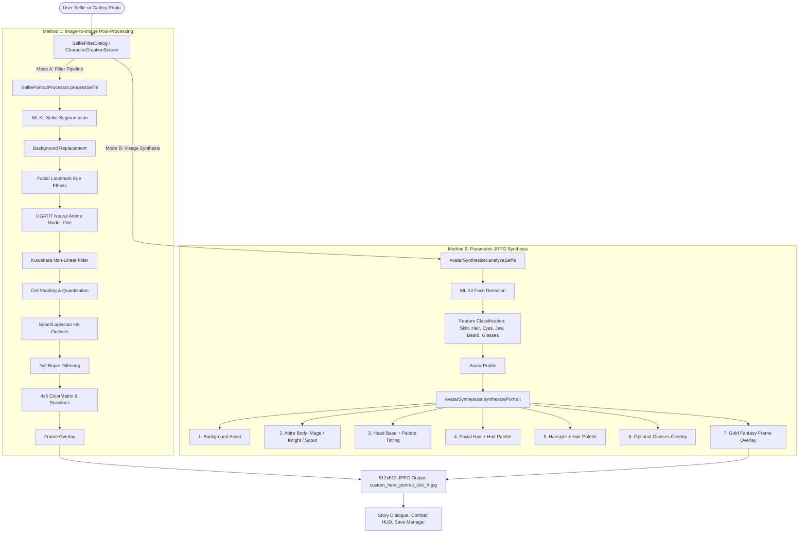

# VoiceRPG Engine: Portrait Generation & Stylization Architecture

This document provides a complete technical specification of the portrait generation and avatar stylization system developed for the VoiceRPG Engine (*Echoes of the Logos* and *Wally's World*).

The system supports **two distinct technical methods** for converting a player's real-world likeness into an in-game portrait:
1. **Method 1: Direct Neural Stylization & Post-Processing Pipeline (`SelfiePortraitProcessor.kt`)** — An image-to-image computer vision and deep learning pipeline that transforms raw camera selfies or uploaded photos through AI subject segmentation, facial landmark shading, TFLite neural style transfer, Kuwahara surface flattening, cel-shading, Bayer dithering, and CRT texture grading.
2. **Method 2: Parametric 16-Bit JRPG Visage Synthesis (`AvatarSynthesizer.kt`)** — An intelligent feature-extraction and procedural sprite-composition engine that analyzes key facial traits (skin tone, eye color, face shape, hair color, hair length, glasses, and facial hair) via Google ML Kit Face Detection, then programmatically constructs an authentic 16-bit JRPG hero portrait matching hand-drawn companions (*Aethel*, *Sir Cedric*, *Lyra*).

---

## 1. High-Level Comparison & System Architecture



### Tradeoffs & Design Objectives

| Dimension | Method 1: Neural Post-Processing | Method 2: Parametric JRPG Synthesis |
| :--- | :--- | :--- |
| **Primary Goal** | Preserve exact real-world photographic identity while applying stylized realm filters. | Produce a 100% authentic, hand-drawn 16-bit JRPG sprite identical in style to bundled game heroes. |
| **Input Source** | Real camera selfie or gallery photo. | Real camera selfie or gallery photo. |
| **Processing Engine** | `SelfiePortraitProcessor.kt` | `AvatarSynthesizer.kt` |
| **Neural Models** | ML Kit Segmentation (`256x256.tflite`) + UGATIT Anime (`anime_style.tflite`, 10.7MB). | ML Kit Face Detection (`FaceDetectorOptions.ACCURATE`). |
| **Visual Character** | Filtered photographic cutout with edge inking, cel-bands, and CRT lines. | Crisp, pixel-perfect JRPG hero avatar with modular attire, hair, and facial hair. |
| **Ideal Game Context** | *Wally's World* (gritty retail memoir, "Associate ID Badge", 3 AM fluorescent grading). | *Echoes of the Logos* (high fantasy epic, ancient runes, golden frame borders). |

---

## 2. Method 1: Direct Neural Stylization & Post-Processing Pipeline

The pipeline in `SelfiePortraitProcessor.kt` operates as a sequential chain of compositing and computer vision stages targeting a uniform $512 \times 512$ canvas.

### 2.1 Camera Capture & EXIF Orientation Normalization

- **Camera Contract:** `TakeSelfiePreviewContract` extends `ActivityResultContracts.TakePicturePreview()`, injecting vendor-specific camera intent extras (`android.intent.extras.CAMERA_FACING = 1`, `LENS_FACING_FRONT = 1`, `USE_FRONT_CAMERA = true`) to prioritize front-facing selfie lenses across Samsung, Google Pixel, Motorola, and Xiaomi devices.
- **Orientation Normalization:** `loadFromUri(context, uri)` parses EXIF metadata (`ExifInterface.TAG_ORIENTATION`) to correct $90^\circ$, $180^\circ$, or $270^\circ$ sensor rotations and horizontal mirroring before any pixel operations begin.
- **Center-Cropping:** `cropAndScale(src, 512)` performs aspect-ratio-preserving square center-cropping followed by bilinear resampling to $512 \times 512$ pixels.

### 2.2 On-Device AI Subject Segmentation & Background Replacement

- **Segmenter Engine:** Uses Google ML Kit Vision Selfie Segmentation (`SelfieSegmenterOptions.STREAM_MODE` disabled for single-frame accuracy).
- **Mask Generation (`runSegmentation`):** Produces a `ByteBuffer` representing a float mask ($0.0 \le \text{confidence} \le 1.0$) for every pixel in the input image.
- **Alpha Matting (`compositeWithBackground`):**
  $$\alpha = \text{clamp}\left(\frac{\text{confidence} - 0.35}{0.85 - 0.35}, 0.0, 1.0\right)$$
  - Pixels with confidence below $0.35$ are completely transparent (background only).
  - Pixels with confidence above $0.85$ are completely opaque subject pixels.
  - Intermediate values are smoothly feathered to prevent harsh edge fringing around hair and shoulders.
- **Background Layering:** Replaces real-world surroundings with in-game environment assets (`fellowship_camp.jpg`, `trench.jpg`, `break_room.jpg`, `crystal_cavern.jpg`, etc.).

### 2.3 Facial Landmark Detection & Eye Shading / Resonance

- **Landmark Engine:** Employs ML Kit Face Detection configured with `LANDMARK_MODE_ALL` and `PERFORMANCE_MODE_ACCURATE`.
- **Landmark Mapping:** Extracts pixel coordinates for `FaceLandmark.LEFT_EYE` and `FaceLandmark.RIGHT_EYE`.
- **Dynamic Shading Modes (`applyEyeShading` / `drawEyeShade`):**
  - **Exhaustion Circles ("Raccoon Eyes" in *Wally's World*):** Renders downward-offset elliptical radial gradients below each eye ($y$-offset factor $0.55$, radius factor $0.28$) with dark purple-magenta coloring (`#872D192A`) to simulate sleep deprivation.
  - **Logos Resonance (in *Echoes of the Logos*):** Renders ethereal cyan-blue luminescence (`#7040C8FF`) centered over the irises to represent ancient magical resonance.

### 2.4 On-Device Deep Neural Anime Stylization (UGATIT TFLite)

When enabled, the pipeline executes inference through an on-device TensorFlow Lite model (`anime_style.tflite`, UGATIT 256x256 generator):

1. **Input Rescaling:** The $512 \times 512$ composite is scaled down to $256 \times 256$.
2. **Tensor Normalization:** Pixel channels in $[0, 255]$ are converted to 32-bit floating point normalized to $[-1.0, 1.0]$:
   $$x_{\text{norm}} = \frac{x}{127.5} - 1.0$$
3. **Model Inference:** Executed on `Dispatchers.Default` using `org.tensorflow.lite.Interpreter`.
4. **Output De-normalization:** The resulting tensor $[-1.0, 1.0]$ is mapped back to standard RGB $[0, 255]$:
   $$x_{\text{pixel}} = \text{clamp}\left((y + 1.0) \times 127.5, 0, 255\right)$$
5. **Upscaling:** The stylized bitmap is rescaled to $512 \times 512$ using bicubic interpolation.

### 2.5 Computer Vision Pixel-Art & Shading Engine

To provide an authentic 16-bit console aesthetic without requiring deep neural weights, `SelfiePortraitProcessor` features a complete procedural image processing stack:

#### A. Kuwahara Non-Linear Edge-Preserving Filter (`applyKuwaharaFilter`)
Photographs contain noisy sub-pixel skin gradients that ruin pixel-art downsampling. The Kuwahara filter ($r = 2$) splits the local window around every pixel into 4 overlapping quadrants, calculates the mean and variance of each, and assigns the pixel the mean value of the quadrant with the **lowest variance**:
$$Q^* = \arg\min_{k \in \{1,2,3,4\}} \sigma_k^2, \quad I_{\text{out}}(x, y) = \mu_{Q^*}$$
This flattens continuous skin and clothing textures into uniform, painterly anime color patches while preserving razor-sharp silhouette edges.

#### B. 16-Bit Grid Quantization & Point Sampling
Downsamples the $512 \times 512$ image to an internal $144 \times 144$ grid (matching SNES/Genesis high-res character screens), then scales back up using nearest-neighbor point sampling (`isFilterBitmap = false`) to enforce authentic square pixel boundaries.

#### C. Cel-Shading & Shadow Cooling (`applyCelShading`)
Calculates perceived luminance:
$$L = 0.299R + 0.587G + 0.114B$$
Luminance is stepped into discrete quantization bands (default: 4 bands). Shadows ($L < 128$) undergo **shadow cooling**, shifting blue channel upwards by factor $0.14$ to mimic traditional animation cels where shadows are painted in cool blues and indigos rather than muddy black.

#### D. Sobel / Laplacian Edge Inking (`applyInkOutlines`)
Applies a 2D spatial convolution filter:
$$K_x = \begin{bmatrix} -1 & 0 & 1 \\ -2 & 0 & 2 \\ -1 & 0 & 1 \end{bmatrix}, \quad K_y = \begin{bmatrix} -1 & -2 & -1 \\ 0 & 0 & 0 \\ 1 & 2 & 1 \end{bmatrix}$$
Where edge magnitude $\sqrt{G_x^2 + G_y^2} > \text{threshold}$, the pixel is replaced with a dark ink color (`#18142A`).

#### E. 2x2 Bayer Matrix Dithering
Adds subtle ordered dithering across tonal boundaries:
$$M_2 = \begin{bmatrix} 0 & 2 \\ 3 & 1 \end{bmatrix} \times \frac{\text{strength}}{4}$$
Softens band transitions without introducing random noise.

#### F. Color Grading & Texture Overlays
- **4x5 ColorMatrix:** Multiplies RGBA vectors by a transformation matrix to inject fantasy golden highlights or cold warehouse fluorescent lighting.
- **Scanlines:** Renders horizontal dark lines (`lineSpacing = 4.0dp`, `lineAlpha = 20-32`) to simulate CRT surveillance or arcade monitors.
- **Vignette:** Applies a radial inverse luminance falloff from center to corners.
- **Ornate Frame Border:** Blends a pixel-perfect gold fantasy frame (`gold_fantasy_frame.png`) over the outermost 26 pixels of the canvas.

---

## 3. Method 2: Parametric 16-Bit JRPG Visage Synthesis

Method 2 (`AvatarSynthesizer.kt`) was developed when testing revealed that direct filtering of arbitrary real-world selfies can produce uncanny or noisy results. Instead of filtering the photo, Method 2 uses on-device AI to **analyze the player's biometric traits** and **programmatically construct a genuine hand-drawn 16-bit JRPG sprite** that matches *Echoes of the Logos*' bundled companions.

### 3.1 Feature Extraction Pipeline (`AvatarSynthesizer.analyzeSelfie`)

The input image is analyzed through `detectFaces(bitmap)` using Google ML Kit:

| Feature | Extraction Algorithm | Output Classes / Indices |
| :--- | :--- | :--- |
| **Skin Tone** | Samples forehead ($x = \text{centerX}$, $y = \text{top} + 0.25h$) and upper cheek pixels with radius $r=10$. Evaluates luminance $L = 0.299R + 0.587G + 0.114B$. | `0`: Fair Alabaster ($L > 215$)<br>`1`: Warm Peach ($L > 175$)<br>`2`: Olive Neutral ($L > 140$)<br>`3`: Golden Tan ($L > 105$)<br>`4`: Deep Espresso ($L \le 105$) |
| **Hair Color** | Samples top-of-head region ($x = \text{centerX}$, $y = \text{top} - 0.12h$) with radius $r=12$. Analyzes channel deltas and luminance. | `0`: Silver / Grey ($|R-G|<20, |G-B|<20, L>140$)<br>`1`: Golden Blonde ($R>170, G>150, B<120$)<br>`2`: Chestnut Brown (Default warm brown)<br>`3`: Raven Black ($L < 55$)<br>`4`: Fiery Auburn ($R > G+35, R > B+40$) |
| **Hair Length / Style** | Measures vertical face bounding box ratio relative to total frame height ($h_{\text{box}} / h_{\text{frame}}$). | `0`: Short Spiky (compact head $0.38 \le \text{ratio} < 0.52$)<br>`1`: Medium Parted ($\text{ratio} \ge 0.52$)<br>`2`: Long Braids (occupies lower frame $\text{ratio} < 0.38$) |
| **Eye Color** | Samples coordinates at `LEFT_EYE` and `RIGHT_EYE` landmarks ($r=3$), evaluating color saturation and hue dominances. | `0`: Logos Sky Blue ($B > R+15, B > G$)<br>`1`: Chestnut Brown (Default)<br>`2`: Forest Emerald ($G > R+8, G > B$)<br>`3`: Golden Hazel ($\text{sat}>0.20, R>120, G>90, B<80$)<br>`4`: Slate Grey ($\text{sat} < 0.12, 60 \le L \le 180$) |
| **Face Shape / Jawline** | Analyzes bounding box aspect ratio ($w_{\text{box}} / h_{\text{box}}$). | `0`: Slender V-Chin ($\text{aspect} < 0.72$)<br>`1`: Square Heroic ($\text{aspect} > 0.82$)<br>`2`: Soft Rounded ($0.72 \le \text{aspect} \le 0.82$) |
| **Glasses Detection** | Samples nose bridge center between eye landmarks and compares luminance to forehead skin tone. | `true`: Bridge $\Delta L > 32$ (dark bridge/wireframes)<br>`false`: Skin matches bridge |
| **Facial Hair Detection** | Compares chin luminance ($y = \text{mouthBottom} + 0.10h$) and philtrum luminance ($y = \text{midpoint}(\text{noseBase}, \text{mouthBottom})$) against forehead skin. | `0`: Clean Shaven ($\Delta L \le 20$)<br>`1`: 5 O'Clock Stubble ($\Delta L > 20$)<br>`2`: Goatee & Mustache ($\text{chin} \Delta L > 35$)<br>`3`: Full Beard ($\text{chin} \Delta L > 42 \land \text{lip} \Delta L > 28$) |

The extracted features populate an immutable `AvatarProfile` data structure:
```kotlin
data class AvatarProfile(
    val skinToneIndex: Int = 1,
    val eyeColorIndex: Int = 0,
    val faceShapeIndex: Int = 0,
    val hairStyleIndex: Int = 0,
    val hairColorIndex: Int = 0,
    val attireIndex: Int = 0,
    val facialHairIndex: Int = 0,
    val hasGlasses: Boolean = false,
    val hasStubble: Boolean = false
)
```

### 3.2 Modular 16-Bit Sprite Layering (`AvatarSynthesizer.synthesizePortrait`)

Once classified, the avatar is composited in exact depth-order onto a $512 \times 512$ canvas using modular pixel assets stored in `assets/game/creation/avatar/`:

```
Layer 7: assets/borders/gold_fantasy_frame.png (Outer frame overlay)
Layer 6: assets/avatar/glasses.png (Optional glasses overlay)
Layer 5: assets/avatar/hair_{spiky|parted|long}.png (Tinted with Hair Palette)
Layer 4: assets/avatar/beard_{stubble|goatee|full}.png (Tinted with Hair Palette)
Layer 3: assets/avatar/head_base_{v|square|round}.png (Tinted with Skin & Eye Palettes)
Layer 2: assets/avatar/body_{mage|knight|scout}.png (Attire body layer)
Layer 1: Background environment asset (fellowship_camp.jpg, etc.)
```

### 3.3 Smart Pixel Palette Tinting Engine (`tintSprite` and `tintEyes`)

The modular PNG assets are drawn with grayscale/neutral reference tones. The engine programmatically re-tints them to match the detected or user-chosen palette using a **4-color luminance ramp**:
- Index 0: Highlight / Specular
- Index 1: Midtone Base
- Index 2: Primary Shadow
- Index 3: Deep Outline Contour

#### Preserving Expressive Facial Landmarks (`tintSprite`)
A naive color replacement would tint eye sclera, pupils, and mouth lines, destroying the character's facial expression. `tintSprite` includes intelligent feature protection:
- **Eye Whites Protected:** Pixels with $R > 240 \land G > 240 \land B > 240$ are preserved untouched.
- **Line Art Protected:** Structural boundary pixels with $R < 35 \land G < 35 \land B < 45$ remain crisp dark contour ink.
- **Eye Irises Protected:** Pixels in the eye coordinate window with blue or green dominance are preserved for the subsequent `tintEyes` pass.

#### Eye Iris Tinting (`tintEyes`)
The `tintEyes` function specifically targets the iris cluster, mapping luminance into the chosen 4-color eye palette (`Logos Sky Blue`, `Forest Emerald`, `Golden Hazel`, `Chestnut Brown`, `Slate Grey`) while preserving the white reflective highlight dot at the top-left of each iris.

---

## 4. Configuration Schema (`selfie_filters.json`)

All portrait generation behavior is data-driven through `assets/game/creation/selfie_filters.json` and parsed into `SelfieFilterConfig.kt`:

```json
{
  "isEnabled": true,
  "disclaimerTitle": "🔮 AWAKENED HERO'S VISAGE",
  "disclaimerText": "Channeling your physical likeness...",
  "disclaimerConfirmButton": "CHANNEL VISAGE ➔",
  "disclaimerCancelButton": "KEEP ANCIENT ILLUSTRATION",
  "sourceDialogTitle": "📸 CAPTURE HERO'S LIKENESS",
  "sourceDialogSubtitle": "Snap a real selfie or select an existing portrait...",
  "filterDialogTitle": "✨ FANTASY JRPG CALIBRATION",
  "filterDialogSubtitle": "Arcane Color Grade & Realm Attunement",
  "filterConfirmButton": "IMBUE PORTRAIT ✔",
  "backgroundToggleLabel": "🏰 Solaria Background",
  "backgroundToggleDescription": "AI hero cutout transported into the realm",
  "availableBackgrounds": [
    { "id": "fellowship_camp", "label": "Fellowship Camp", "assetPath": "story/fellowship_camp.jpg" }
  ],
  "frameBorderAsset": "game/creation/borders/gold_fantasy_frame.png",
  "avatarSynthesis": {
    "enabledByDefault": true,
    "label": "⚔️ JRPG Hero Visage Synthesis",
    "description": "Synthesizes an authentic 16-bit Solaria hero portrait matching Aethel",
    "defaultAttireIndex": 0,
    "skinToneLabels": ["Fair Alabaster", "Warm Peach", "Olive Neutral", "Golden Tan", "Deep Espresso"],
    "eyeColorLabels": ["Logos Sky Blue", "Chestnut Brown", "Forest Emerald", "Golden Hazel", "Slate Grey"],
    "faceShapeLabels": ["Slender V-Chin", "Square Heroic", "Soft Rounded"],
    "hairStyleLabels": ["Short Spiky", "Medium Parted", "Long Braids"],
    "hairColorLabels": ["Silver / Grey", "Golden Blonde", "Chestnut Brown", "Raven Black", "Fiery Auburn"],
    "facialHairLabels": ["Clean Shaven", "5 O'Clock Stubble", "Goatee & Mustache", "Full Beard"],
    "attireLabels": ["Solaria Mage Robe", "Paladin Gold Plate", "Forest Scout Mantle"]
  },
  "pixelArt": {
    "enabledByDefault": true,
    "label": "🎮 Retro JRPG Pixel Art",
    "description": "16-bit Chronicle pixel grid with discrete color shading",
    "gridResolution": 144,
    "kuwaharaRadius": 2,
    "paletteBands": 4,
    "ditherStrength": 0.08,
    "shadowCoolingFactor": 0.14,
    "outlineSensitivity": 1.05,
    "outlineColorHex": "#18142A"
  },
  "tfliteStylization": {
    "enabledByDefault": false,
    "modelAssetPath": "game/creation/models/anime_style.tflite",
    "label": "🎨 JRPG Anime Neural Style",
    "inputSize": 256
  }
}
```

---

## 5. Storage & Lifecycle Integration

- **Slot-Specific Persistence:** Custom portraits are saved to Android internal app storage under `files/custom_hero_portrait_slot_{0..3}.jpg` via `SelfiePortraitProcessor.saveCustomPortrait(context, bitmap, slot)`.
- **Save Isolation:** Slot 0 (Story 1), Slot 1 (Story 2), Slot 2 (Story 3), and Slot 3 (Pure Story Mode) maintain independent custom portraits. Resetting or deleting a save slot automatically purges its associated custom portrait file.
- **Runtime Resolution:** `StoryAssetLoader.loadCustomPortraitBitmap` checks for a slot-specific custom portrait on disk; if absent or disabled, it falls back seamlessly to `GameContent.manifest.defaultHeroPortrait` (`portraits/aethel.jpg` or `portraits/todd.jpg`).

---

## 6. Directory Catalog of `portrait-gen/`

This standalone documentation folder bundles all engine source files, component assets, neural models, reference portraits, and test scripts:

```
portrait-gen/
├── README.md                                  # This comprehensive technical guide
├── src/                                       # Engine source code
│   ├── AvatarSynthesizer.kt                   # Method 2: Parametric feature analysis & sprite synthesis
│   ├── SelfiePortraitProcessor.kt             # Method 1: Computer vision & TFLite filter pipeline
│   ├── SelfieFilterConfig.kt                  # Data model for filter and avatar configurations
│   ├── SelfieFilterDialog.kt                  # Jetpack Compose calibration modal with live preview
│   └── CharacterCreationScreen.kt             # Hero creation screen integration
├── assets/
│   ├── avatar/                                # 16-bit modular sprite component layers
│   │   ├── head_base.png                      # Slender V-Chin head base
│   │   ├── head_base_square.png               # Square Heroic jawline
│   │   ├── head_base_round.png                # Soft Rounded jawline
│   │   ├── body_mage.png                      # Solaria Invocator Robe
│   │   ├── body_knight.png                    # Paladin Gold Plate Armor
│   │   ├── body_scout.png                     # Forest Scout Mantle
│   │   ├── hair_spiky.png                     # Short Spiky Hairstyle (Aethel default)
│   │   ├── hair_parted.png                    # Medium Parted Hairstyle (Cedric default)
│   │   ├── hair_long.png                      # Long Braids Hairstyle (Lyra default)
│   │   ├── beard_stubble.png                  # 5 O'Clock Stubble overlay
│   │   ├── beard_goatee.png                   # Goatee & Mustache overlay
│   │   ├── beard_full.png                     # Full Beard overlay
│   │   ├── stubble.png                        # Fine shadow stubble
│   │   └── glasses.png                        # Scholar spectacles overlay
│   ├── borders/
│   │   └── gold_fantasy_frame.png             # Authentic ornate gold fantasy frame border
│   ├── models/
│   │   └── anime_style.tflite                 # UGATIT 256x256 deep neural anime transfer model
│   ├── configs/
│   │   ├── selfie_filters_echoes_of_logos.json# Fantasy JRPG settings (Echoes of the Logos)
│   │   └── selfie_filters_wallys_world.json   # Dark retail memoir settings (Wally's World)
│   └── reference_portraits/
│       ├── aethel.jpg                         # Canonical Invocator reference portrait
│       ├── cedric.jpg                         # Canonical Paladin reference portrait
│       ├── lyra.jpg                           # Canonical Scout reference portrait
│       └── todd_retail.jpg                    # Canonical Retail Associate reference portrait
└── scripts/
    └── generate_matrix_preview.py             # Python script generating 3x3 Attire vs Hairstyle matrix
```

---

## 7. How to Test & Extend

### Running the Python Matrix Test
To verify component alignment and sprite layering on a local machine:
```bash
python3 portrait-gen/scripts/generate_matrix_preview.py
```
This generates `portrait-gen/assets/matrix_preview.png`, rendering a $1536 \times 1536$ grid containing all 9 combinations of Attire (Mage, Knight, Scout) and Hairstyles (Spiky, Parted, Long) composited with the base head and gold frame border.

### Adding New Component Layers
1. **New Hairstyle:** Create a $512 \times 512$ transparent PNG in neutral/grayscale coloring (`hair_<name>.png`), place it in `assets/game/creation/avatar/`, and add its key to `AvatarProfile.hairStyleIndex` and `AvatarSynthesizer.synthesizePortrait`.
2. **New Attire:** Create a $512 \times 512$ transparent PNG with the character collar positioned at $x \approx 256, y \approx 280-320$, place it in `assets/game/creation/avatar/`, and add its label to `selfie_filters.json` under `avatarSynthesis.attireLabels`.
3. **New Color Palettes:** Append 4-color integer arrays to `AvatarSynthesizer.SKIN_PALETTES`, `HAIR_PALETTES`, or `EYE_PALETTES`.
